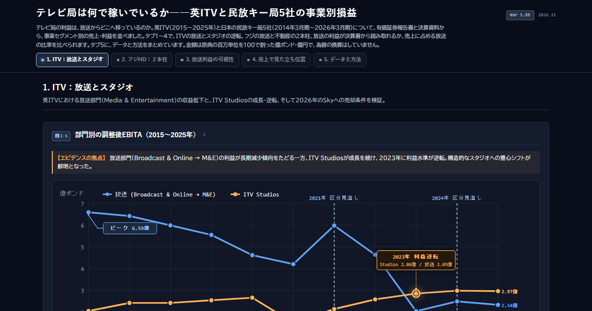

# テレビ局は何で稼いでいるか――英ITVと民放キー局5社の事業別損益 (broadcaster-segment-cutline-dashboard)

[](LICENSE)
[](LICENSE-CONTENT.md)
[](#)
[](#)



テレビ局の利益は、放送からどこへ移っているのか。英ITV（2015〜2025年）と日本の民放キー局5社（2014年3月期〜2026年3月期）について、有価証券報告書と決算資料から、事業セグメント別の売上・利益を並べました。タブ1〜4で、ITVの放送とスタジオの逆転、フジの放送と不動産の2本柱、放送の利益が決算書から読み取れるか、売上に占める放送の比率を比べられます。タブ5に、データと方法をまとめています。金額は原典の百万単位を100で割った億ポンド・億円で、為替の換算はしていません（**Ver 1.58**）。

画面右上の「日本語／English」で英語表示に切り替えられます（英語版の直接リンク：`?lang=en` を付ける。例 `https://naohisastry.github.io/broadcaster-segment-cutline-dashboard/?lang=en#fig-2-1`）。

note連載『どこで切るか』の図の出典となるダッシュボードです。

一次開示データベースに基づき、英ITV（2015〜2025年の放送 vs スタジオ財務時系列、2026年Sky売却条件）および日本の民放キー局5社（フジ・メディアHD、TBS HD、テレビ朝日HD、テレビ東京HD、日本テレビHD）のセグメント開示実績値を直接グラフ化・可視化しています。

---

## 🌐 公開URL（Live Dashboard）

* **公開URL（予定）**: [https://naohisastry.github.io/broadcaster-segment-cutline-dashboard/](https://naohisastry.github.io/broadcaster-segment-cutline-dashboard/)
  *(ユーザー承認後に GitHub へプッシュ・公開予定)*

### 🔗 関連リンク
* **フジ・メディアHD 事業別の収益とキャッシュフロー**: [https://naohisastry.github.io/broadcaster-financials-fuji-media-hd/](https://naohisastry.github.io/broadcaster-financials-fuji-media-hd/)

---

## 📊 ダッシュボードの構成（全5タブ）

本ダッシュボードは、データベースの定量的可視化（グラフ・時系列・比較）に特化しています（※切断線マップや各社原文引用などのデザイン中心のインフォグラフィックは記事等で展開）。

| タブ | アンカーID | 主な可視化内容 | エビデンスの焦点 |
|---|---|---|---|
| **1. ITV：放送とスタジオ** | `#fig-1-1`<br>`#fig-1-2`<br>`#fig-1-3`<br>`#fig-1-4`<br>`#fig-1-5` | ・調整後EBITA推移（2015-25）<br>・Studios売上の内外比率<br>・放送売上と広告収入（定義切替切断）<br>・Skyへの売却条件スコアカード群<br>・部門定義変更履歴（全15件） | 放送利益が長期低迷する一方、ITV Studiosが伸長し2023年に利益逆転。Skyへ最大£1.6bnで放送売却合意し、5年約21億ポンドの番組供給契約を締結。 |
| **2. フジHD：２本柱** | `#fig-2-1`<br>`#fig-2-2` | ・２本柱セグメント利益（2018-26）<br>・区分変更から外部資本検討への時系列年表 | 2018年に「メディア・コンテンツ」と「都市開発・観光」へ区分再編。都市開発が利益の過半を稼ぐ年度が常態化し、2026年に外部資本導入検討を開始。 |
| **3. 放送利益の可視性** | `#fig-3-1`<br>`#fig-3-2` | ・放送利益比率推移（旧区分実線／新区分破線／終了×印）<br>・テレ東2023年の旧区分（77.5%）vs新区分（45.4%）横棒比較 | フジ（2018年）とTBS（2019年）は区分変更で放送単独利益の開示終了。テレ東は同一年度でも区分の引き方で放送比率が32ポイント変動。 |
| **4. 売上で見た立ち位置** | `#fig-4-1`<br>`#fig-4-2` | ・売上に占める放送比率スロープ図（2015→2026）<br>・利益と売上の開示状況対比表 | 売上では全社で放送依存度低下が追跡できるが、利益面では放送単独を開示する企業が限定される非対称性を可視化。 |
| **5. データと方法** | ― | ・全CSVダウンロード<br>・方法論・前提条件・不連続性の扱い | 手入力・推計を排除し、一次開示データと算出値を完全透明化。 |

---

## 🛠 技術スタック・設計方針

- **外部ライブラリ非依存（Zero Dependencies）**: 単一の静的HTML＋Vanilla JavaScript＋インラインSVGのみで構築。CDN等の外部通信を排除し、完全オフラインでも高速かつ堅牢に動作。
- **配色トークン**: TV-Shift 2035 v2 と共通の配色仕様（`--bg:#0a0e1a; --panel:#111726; --card-bg:#141c2e; --accent:#9cc2f0; --warn:#ffb35c;`）。強調色は `--warn` の1色に限定。
- **レスポンシブ**: スマートフォン幅（390px等）でも横スクロールが発生せず、全チャート・テーブル・カードが快適に閲覧可能。

---

## 📁 フォルダ構成

```
broadcaster-segment-cutline-dashboard/
├── broadcaster-segment-cutline-dashboard-v1.58.html  # ダッシュボード本体（Ver 1.58 正本）
├── index.html                                        # GitHub Pages / サーバー用ルートエイリアス（Ver 1.58同期）
├── data_v1.1.js                                      # 構造化データセット（最新版データ）
├── i18n_core_v1.0.js                                 # 日英切り替えの仕組み（英語表示のときだけ置き換え）
├── i18n_en_v1.1.js                                   # 英語の辞書と換算規則（¥bn・£m・FY表記）
├── social-preview.png                                # OGP標準画像（1200×630px）
├── README.md                                         # 本文書
├── DATA_SOURCES.md                                   # データソース・原典一覧
├── METHODOLOGY.md                                    # 分析方針・不連続性の扱い・前提
├── CHANGELOG.md                                      # 更新履歴
├── LICENSE                                           # MITライセンス（コード）
├── LICENSE-CONTENT.md                                # CC BY 4.0ライセンス（文章・データ・図表）
└── .gitignore                                        # Git除外設定
```

---

## 🇬🇧 English

**How TV Broadcasters Make Money: Segment Results of ITV and Japan's Five Key Commercial Broadcasters**

Where are TV broadcasters' profits moving, away from broadcasting? This dashboard lines up revenue and profit by business segment for the UK's ITV (FY12/2015–FY12/2025) and Japan's five key commercial broadcasters (FY3/2014–FY3/2026) — Fuji Media HD, Nippon TV HD, TBS HD, TV Asahi HD and TV Tokyo HD — taken from annual securities reports and results materials.

- **Live (English):** https://naohisastry.github.io/broadcaster-segment-cutline-dashboard/?lang=en
- Switch language with **日本語 / English** at the top right. The choice is remembered on your device; `?lang=en` or `?lang=ja` in the URL always takes priority. Section links (e.g. `#fig-2-1`) work in both languages.

| Tab | What it shows |
|---|---|
| 1. ITV: Broadcasting vs Studios | Adjusted EBITA by division, Studios intra-group vs external revenue, advertising revenue (NAR→TAR break), terms of the 2026 sale of M&E to Sky, 15 division definition changes |
| 2. Fuji HD: Two Pillars | Segment profit of Media & Content and Urban Development, Hotels & Resorts; timeline to the 2026 review of outside capital |
| 3. How Visible Is Broadcast Profit? | Broadcasting's share of segment profit, and where it stops being disclosed |
| 4. Broadcasting's Share of Revenue | Slope chart FY3/2015 → FY3/2026, and profit vs revenue disclosure |
| 5. Data & Methods | All CSVs, definitions and treatment of discontinuities |

**Conventions in the English version**

- Amounts stay in each company's reporting currency, with no FX conversion: **£m** for ITV, **¥bn** for Japanese broadcasters. Tables and CSVs keep the original units (£m, ¥m).
- Japanese fiscal years are shown as **FY3/2026** (year ending March 2026); ITV as **FY12/2025**.
- Segment names follow each company's official English disclosures.
- Translations of Japanese quotes are the author's.

---

## 📜 ライセンス

- **コード**: [MIT License](LICENSE)
- **コンテンツ・データ**: [Creative Commons Attribution 4.0 International License (CC BY 4.0)](LICENSE-CONTENT.md)
  - 企画・分析・データ設計：Naohisa Hashimoto (Media Architect)
